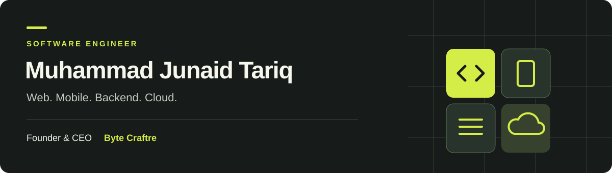

  

  
  

<b>Building across the application lifecycle.</b> 
Web and mobile experiences, backend systems, databases, and application delivery.

 

## About

I'm a software engineer working across web, mobile, and backend systems. My work spans application architecture, frontend and backend development, API integration, cloud infrastructure, and deployments.

I have contributed to financial research, industrial monitoring, business operations, and legal research applications, working alongside engineering teams to turn requirements into usable software.

 

## Selected work

PROFESSIONAL CONTRIBUTIONS · DATA FUNCTION INC.

The following are company and client applications I contributed to as part of engineering teams.

### 01 / [NeuraCap](https://neuracap.ai)
**Financial research & valuation**

Developed interfaces for valuations, peer comparisons, M&A research, and financial reports. Contributed to application architecture decisions, API and AI assistant integrations, cloud infrastructure, and deployments.

`Next.js` `React` `TypeScript` `API Integration` `AWS`

---

### 02 / [Force-V](https://datafunction.ca/work/force-v)
**Industrial monitoring · Web & mobile**

Built monitoring and reporting interfaces across web and mobile. Contributed to SQL data ingestion, EMQX integration, testing, and application delivery. Both codebases use JavaScript.

`React` `React Native` `Expo` `JavaScript` `SQL` `EMQX`

---

### 03 / [StoneCloud](https://stonecloud.jinnahtech.com)
**Marble industry software**

Developed application interfaces and contributed to inventory business logic and MySQL database functionality. Collaborated on backend integration, deployments, and ongoing application support.

`React` `JavaScript` `MySQL` `Business Logic` `Deployment`

---

### 04 / [Case Polaris](https://casepolaris.com)
**Legal research · Web & mobile**

Contributed to the Next.js web application and React Native/Expo mobile application using TypeScript. Worked on research interfaces, document and chat workflows, API integration, and delivery. Mobile development is ongoing.

`Next.js` `React Native` `Expo` `TypeScript` `API Integration`

 

## Engineering toolkit

**Languages**  
`JavaScript` `TypeScript` `Python` `SQL`

**Web, mobile & backend**  
`React` `Next.js` `React Native` `Expo` `Django` `REST APIs`

**Data, infrastructure & delivery**  
`MySQL` `AWS` `Docker` `Git` `GitHub Actions` `EMQX` `RabbitMQ`

<b>Earlier engineering work</b>

 

My university IoT diagnostic-system project combined Java/Spring Boot APIs, a React interface, and Python/Flask device integration. It was an academic team project.

 

---

<b>Let's build useful software.</b> 
<a href="https://www.linkedin.com/in/immjunaidtariq/">LinkedIn</a>

Based in Pakistan · Web, mobile, backend and cloud

